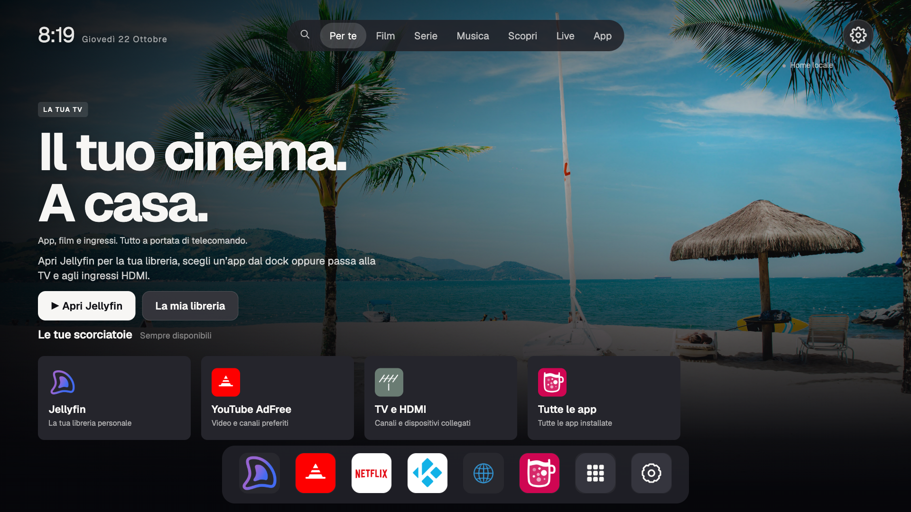
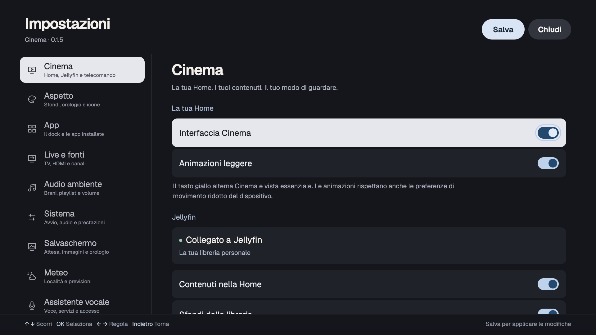
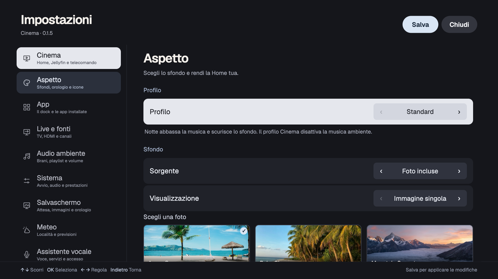
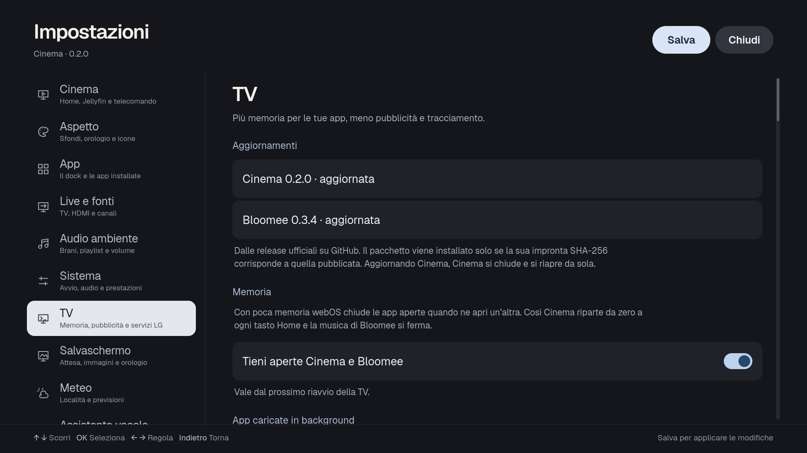

# Cinema

Una Home per TV LG webOS con interfaccia ispirata a Google TV, icone native e libreria Jellyfin. Progettata per essere leggibile dal divano e navigabile con il telecomando, anche su TV con risorse limitate.

## Schermate



<p align="center">
  
  
</p>

<p align="center"></p>

Schermate del preview a 1920×1080, con dati personali omessi. La Home locale resta disponibile anche senza Jellyfin.

## Cosa offre

- Film, serie, riprendi visione con i prossimi episodi e album musicali Jellyfin, con cache e una Home locale sempre utilizzabile. L'account si collega dalla TV con Quick Connect.
- Live TV subito dietro ai controlli, selezione delle fonti e passaggio alla visione a schermo intero.
- Scopri e richieste tramite Litefin e il servizio Seerr già configurato sul server.
- Impostazioni a schermo intero: categorie con icone, righe grandi, interruttori e focus leggibile.
- Preferenze Cinema per animazioni, sfondi Jellyfin, ombra dei titoli Live e gestione dell’interfaccia.
- App e dock personalizzabili, sfondi, profili, musica ambiente, meteo, salvaschermo, backup, diagnostica e assistente vocale opzionale.

## Barra delle app

In Impostazioni → App → **Barra delle app** si sceglie **Estesa** (predefinita: una fila a tutta larghezza di riquadri uguali con il nome sempre visibile, e gli ingressi HDMI come riquadri, attenuati con «Nessun segnale») oppure **Compatta** (il dock centrato con le sole icone). All'avvio Cinema mostra subito l'ultima barra costruita, anche quando webOS l'aveva chiusa per liberare memoria.

## Strumenti TV

La scheda Impostazioni → **TV** richiede una TV con root (Homebrew Channel) e Python, che webOS include. Mostra solo quello che la TV in uso ha davvero: un'impostazione, un servizio o un tasto che il televisore non conosce non compare. Tutto si salva con **Salva** e si annulla con **Ripristina tutto come LG**.

- **Aggiornamenti**: Cinema e Bloomee dalle release ufficiali su GitHub, installati solo se l'impronta SHA-256 corrisponde a quella pubblicata. Una volta al giorno Cinema avvisa quando esce una versione nuova; niente viene installato senza il pulsante.
- **Memoria**: tiene aperte Cinema e Bloomee quando si apre un'altra app, così Home non riparte da zero e la musica non si ferma.
- **App caricate in background**: toglie dal precaricamento di LG le app che non usi (su webOS 5 vale dal riavvio successivo).
- **Pubblicità e tracciamento**: ID pubblicitario, Live Plus, promozioni e avvisi restano spenti; se LG li riaccende, Cinema li rispegne.
- **Servizi LG in background**: analisi dei contenuti, invio di log e diagnostica, suggerimenti, fermati a ogni avvio.
- **Tasti del telecomando**: Netflix, Prime Video, i tasti colorati, Guida, Info e gli altri che la TV riconosce possono aprire Cinema, Bloomee, un ingresso o un'app, da qualsiasi app, già prima che Cinema sia partita.
- **Accordi sui dati**: gli accordi accettati con LG, ciascuno con il suo interruttore. Spegnendone uno si ritira anche il documento da cui dipende, così non torna acceso al riavvio; i termini d'uso non vengono toccati.

In Impostazioni → Salvaschermo, **Spegni la TV durante il salvaschermo** manda la TV in standby dopo 1-8 ore di salvaschermo di Cinema senza tasti premuti: un film o un'app in uso non vengono mai interrotti.

Dopo l'avvio e il risveglio dallo standby, se LG rimette in primo piano l'ultimo ingresso usato sopra Cinema, Cinema torna davanti da sola.

### Sicurezza

Su una TV con Homebrew Channel ogni app installata può già eseguire comandi come root attraverso il servizio di Homebrew Channel: Cinema non aggiunge un accesso che non ci sia già. Dove invece una cartella scrivibile da tutti potrebbe far scrivere root in un posto sbagliato, Cinema lo evita: il servizio TV gira da una copia in `/var/lib/launch-home-cinema` accessibile solo a root, i suoi file temporanei stanno in `/run/cinema-tvtools` (0700, senza seguire link simbolici), e gli aggiornamenti vengono scaricati e controllati in una cartella temporanea di root, non nella `/media/developer/temp` condivisa.

**Home** apre Cinema quando la rimappatura è configurata. Il **tasto giallo** alterna Cinema e vista essenziale. **Salva** applica le preferenze; **Chiudi** scarta le modifiche non salvate. Le animazioni sono brevi, disattivabili e rispettano il movimento ridotto.

## Build

```sh
npm ci
npm test
npm run pack
```

Il pacchetto mantiene l’ID applicazione esistente per conservare aggiornamenti, configurazione e hook. Non installare aggiornamenti di un’altra distribuzione se vuoi mantenere questa interfaccia.

[CINEMA.md](CINEMA.md) descrive configurazione, integrazione Jellyfin/Litefin, avvio e tasto Home. [VALIDATION.md](VALIDATION.md) riporta le verifiche sulla TV e i loro limiti.

Le credenziali rimangono sul dispositivo o sul server, fuori da sorgenti, pacchetto e backup delle preferenze Cinema.

## Origine e licenze

Basato su [gprot42/webos-launch-home](https://github.com/gprot42/webos-launch-home). La licenza originale è conservata in [LICENSE](LICENSE); altre attribuzioni e licenze degli asset sono indicate nei sorgenti e in CINEMA.md. Gli Strumenti TV adattano tecniche di [Glasshouse](https://github.com/rorygallagher2024/glasshouse) (precaricamento via configd, filtro dei tasti nel compositore, accordi sui dati, servizi; MIT) e di [TV Tools](https://github.com/theo78825/tv-tools-public) (impostazioni LG tenute spente, spegnimento dopo il salvaschermo; MIT); la barra estesa si ispira a [Minimal Home](https://github.com/SchulzCode/WebOS-Minimal-Launcher).

## Client Jellyfin e Scopri

In Impostazioni → Cinema si può scegliere il client preferito oppure Automatico. Cinema riconosce Litefin, Moonfin, Jellyfin, Breezyfin e OcenFin. L'elenco dello store indica webOS 5+ per Litefin, Moonfin e Jellyfin, 7+ per Breezyfin e 10+ per OcenFin: la disponibilità dipende dal televisore. Nessun client aggiuntivo viene installato automaticamente.

I collegamenti diretti ai dettagli e alla ripresa usano l'adattatore Litefin opzionale; gli altri client si aprono nella propria interfaccia. Scopri resta sempre visibile. Con Litefin e il collegamento Seerr verificato apre direttamente il catalogo; con Moonfin spiega come usare la sua integrazione Seerr; con gli altri client offre l'apertura della libreria e la scelta di un client adatto. Senza app, account o server disponibili mostra un percorso di configurazione, lasciando accessibili Home, app e TV.

In Live i controlli spariscono dopo 10 secondi senza interazioni. Schermo intero li nasconde subito; OK o una freccia li riaprono. Lo sfondo della Home resta visibile mentre l'immagine sostitutiva si carica.
